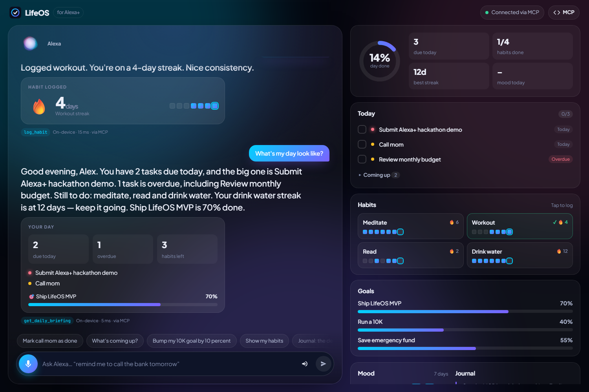
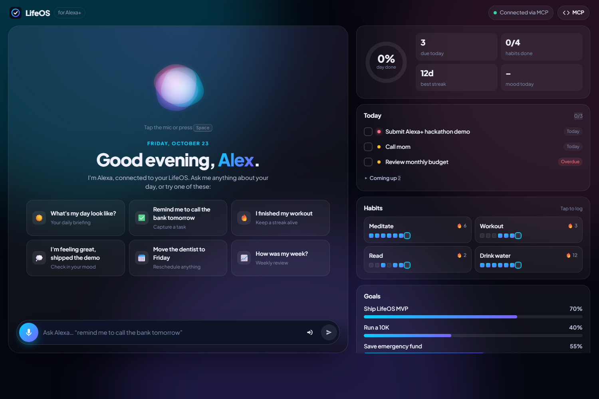
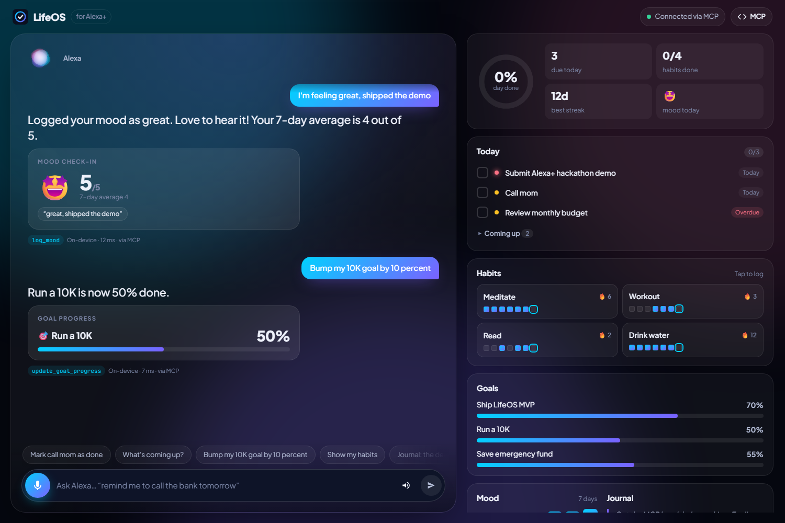
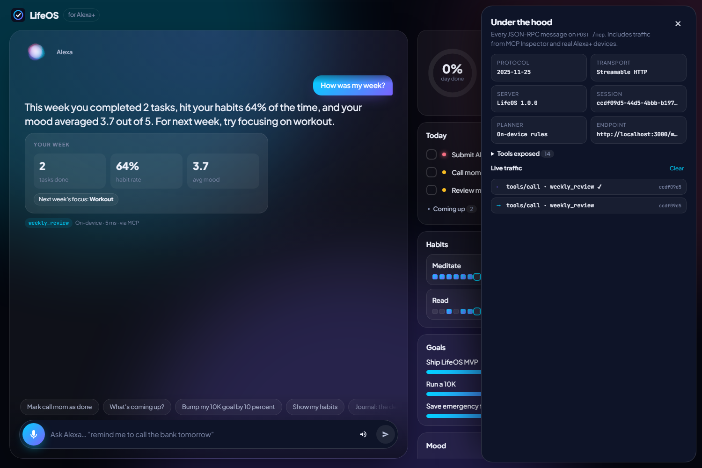
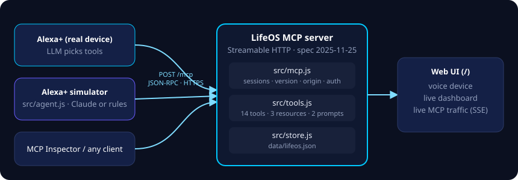

# LifeOS for Alexa+

**Run your life by voice.** LifeOS is a personal operating system for tasks, habits, goals, mood and journaling, available to Alexa+ through a **self-hosted MCP server** (spec **2025-11-25**, **Streamable HTTP**).

The repo also has a **simulated Alexa+ experience** (a web app with voice in and out) that talks to the server over real MCP. You can see it working with no Alexa device and no API keys.

> "Alexa, what's my day look like?"
> *"Good morning, Alex. You have 2 tasks due today, and the big one is Submit Alexa+ hackathon demo. 1 task is overdue… Your meditate streak is at 7 days — keep it going."*



| Home | Mood & goals | MCP under the hood |
|---|---|---|
|  |  |  |



---

## What's inside

| Piece | Path | What it does |
|---|---|---|
| **MCP server** | [`src/mcp.js`](src/mcp.js) | Streamable HTTP transport, spec 2025-11-25. No dependencies: every protocol rule it follows is in this one file. |
| **LifeOS tools** | [`src/tools.js`](src/tools.js) | 14 tools, 3 resources, 2 prompts. Each tool returns voice-ready `speech` plus `structuredContent`. |
| **Data store** | [`src/store.js`](src/store.js) | A JSON file (`data/lifeos.json`) with seeded demo data. You can swap it for a real database. |
| **Alexa+ simulator** | [`src/agent.js`](src/agent.js), [`public/`](public/) | An MCP *client* that plays the Alexa+ role: it discovers tools and picks one per utterance (with Claude, or offline rules). It calls tools over HTTP and speaks the result. |
| **Smoke test** | [`scripts/smoke-test.mjs`](scripts/smoke-test.mjs) | 41 checks covering the spec's transport rules, tools, resources, prompts and simulator routing. |

### Tools

| Tool | Hints | Example utterance |
|---|---|---|
| `get_daily_briefing` | read-only | "What's my day look like?" / "Good morning" |
| `add_task` | | "Remind me to call the bank tomorrow, it's urgent" |
| `list_tasks` | read-only | "What's overdue?" / "What's coming up?" |
| `complete_task` | idempotent | "Mark call mom as done" |
| `reschedule_task` | idempotent | "Move the dentist to Friday" |
| `delete_task` | **destructive** | "Delete the grocery task" |
| `log_habit` | idempotent | "I meditated" / "I finished my workout" |
| `get_habits` | read-only | "Show my habits" |
| `create_habit` | | "Start tracking stretching" |
| `log_mood` | | "I'm feeling stressed about the deadline" |
| `add_journal_entry` | | "Journal: the demo finally clicked today" |
| `get_goals` | read-only | "How are my goals?" |
| `update_goal_progress` | | "Bump my 10K goal by 10 percent" |
| `weekly_review` | read-only | "How was my week?" |

Resources: `lifeos://today`, `lifeos://tasks`, `lifeos://habits`. Prompts: `plan_my_day`, `evening_reflection`.

### MCP spec compliance (2025-11-25, Streamable HTTP)

- A single `/mcp` endpoint. `POST` carries exactly one JSON-RPC message, and batches are rejected (batching was removed in 2025-06-18).
- Requests get `application/json`. Clients whose `Accept` header allows only `text/event-stream` get a single-event SSE stream.
- Notifications and client responses get **202 Accepted** with no body.
- `initialize` negotiates the version (2025-11-25, with fallback to 2025-06-18 and 2025-03-26) and issues an **`MCP-Session-Id`**. A request with no session ID gets **400**. An unknown or expired session ID gets **404**. `DELETE` ends a session.
- The **`MCP-Protocol-Version`** header is validated. An unsupported version gets **400**.
- The **`Origin`** header is validated against DNS rebinding (**403**). The server binds to `127.0.0.1` by default.
- `GET` returns **405**, because this server never opens a server-initiated stream.
- Tools have `title`, `outputSchema` + `structuredContent`, and `annotations` (`readOnlyHint` / `destructiveHint` / `idempotentHint`). `serverInfo` has `title`, `description`, `websiteUrl` and `icons`.
- Bad tool arguments come back as a tool execution error (`isError: true`), so the model can correct itself. An unknown tool gets JSON-RPC `-32602`.
- Optional bearer-token auth (`LIFEOS_API_KEY`) returns **401** with `WWW-Authenticate`.

---

## Quick start

Requires Node 20 or later.

```bash
npm install          # only installs the optional Claude SDK; the server itself has zero deps
npm start
```

Open **http://localhost:3000**. Click the mic or press **Space** to talk (in Chrome or Edge). You can also type, or tap a starter card.

- **The Alexa+ stage.** A living orb follows your microphone level while you speak and pulses while Alexa talks. Replies appear word by word and are read aloud. Each answer also comes with a visual card, such as a briefing, a streak flame, a mood check-in, goal progress or a weekly review. Confetti marks milestones.
- **Your LifeOS panel.** A "day done" ring, tasks you can tick off, habits you can log with one tap, goals, a 7-day mood chart and your latest journal entry. Taps go through MCP too, so they count as real tool calls.
- **Under the hood.** Press **D** or click **MCP** to open a drawer with protocol facts, the tool list with annotations, and live JSON-RPC traffic from *any* client, including the Inspector or Alexa+ itself.

It works on mobile, follows your system's light or dark setting, and respects reduced-motion preferences.

**Demo links:** `/?ask=What's my day look like?` runs a request automatically on load (repeat `ask=` for a sequence), and `/?dev=1` opens the drawer.

```bash
npm test             # 41 checks against spec rules + simulator routing
npm run reset        # restore demo data before recording
```

### Let Claude pick the tools (optional)

By default the simulator uses an offline intent router, so it works without keys. To make the simulator act like a real LLM-driven assistant, set an Anthropic API key. Claude then gets the live `tools/list` from the MCP server and decides which tools to call, chaining several when needed (e.g. *"I finished the demo and I'm feeling amazing"*).

```bash
export ANTHROPIC_API_KEY=sk-ant-...     # PowerShell: $env:ANTHROPIC_API_KEY="sk-ant-..."
npm start
```

The default model is `claude-opus-5-5` at low effort, to keep voice latency down. You can override it with `ALEXA_SIM_MODEL`. Server-side refusal fallbacks are enabled. If a Claude call fails, the simulator falls back to the rules planner for that turn.

### Inspect it with the official MCP Inspector

```bash
npx @modelcontextprotocol/inspector --cli http://localhost:3000/mcp --transport http --method tools/list
npx @modelcontextprotocol/inspector     # GUI: Transport "Streamable HTTP", URL http://localhost:3000/mcp
```

---

## Connect it to Alexa+

Alexa+ connects to a remote MCP server over HTTPS. To give it one:

1. **Expose the server over HTTPS.**
   ```bash
   # quick tunnel for testing
   cloudflared tunnel --url http://localhost:3000      # or: ngrok http 3000
   ```
   Or deploy the container (below) to any host. Your endpoint will look like `https://<host>/mcp`.
2. **Lock it down.** Set `LIFEOS_API_KEY` to a long random value, so every request has to send `Authorization: Bearer <key>`. Set `ALLOWED_ORIGINS` if browsers on other origins need access.
3. **Register the endpoint** in the Alexa+ developer console for your experience, following the Alexa+ MCP onboarding docs for your preview cohort. Give it the `/mcp` URL and auth details.
4. **Watch it work.** Keep `http://localhost:3000` open while you talk to your Alexa+ device. Its requests show up in the MCP traffic panel, and the dashboard updates as it changes your data.

Before you go live, check your server against the cloud endpoint:

```bash
MCP_URL=https://<host>/mcp npm test
```

### Docker

```bash
docker build -t lifeos-mcp .
docker run -p 3000:3000 -e LIFEOS_API_KEY=change-me -v lifeos-data:/app/data lifeos-mcp
```

### Configuration

| Variable | Default | Purpose |
|---|---|---|
| `PORT` | `3000` | HTTP port |
| `HOST` | `127.0.0.1` | Bind address (`0.0.0.0` in Docker) |
| `LIFEOS_API_KEY` | *unset* | Require `Authorization: Bearer <key>` on `/mcp` |
| `ALLOWED_ORIGINS` | *localhost only* | Comma-separated browser origins allowed to call `/mcp` (`*` for any) |
| `LIFEOS_DATA_FILE` | `data/lifeos.json` | Where data is stored |
| `LIFEOS_USER_NAME` | `Alex` | Name used in briefings |
| `ANTHROPIC_API_KEY` | *unset* | Turns on the Claude planner in the simulator |
| `ALEXA_SIM_MODEL` | `claude-opus-5-5` | Model for the Claude planner |
| `ALEXA_SIM_PLANNER` | auto | Set to `rules` to force the offline planner |

---

## Plugging in your existing LifeOS MVP

All data access goes through [`src/store.js`](src/store.js) (`load`, `mutate`, `save`) and the tool handlers in [`src/tools.js`](src/tools.js). To put this MCP server in front of an existing LifeOS backend, replace the bodies of those handlers with calls to your API or database. The MCP layer, the simulator and the tests stay the same.

## Demo script (≈2 min)

1. **Setup.** Show the three panels and point out the header pills: `MCP 2025-11-25 · Streamable HTTP`, 14 tools, and the session ID.
2. **Briefing.** *"Alexa, what's my day look like?"* Expand `tools/call → get_daily_briefing` in the traffic panel to show the request, then the `structuredContent` response.
3. **Capture.** *"Remind me to call the bank tomorrow, it's urgent."* The task appears in Upcoming with a red priority dot.
4. **Habits.** *"I finished my workout."* The streak goes up and the week grid fills in.
5. **Feelings.** *"I'm feeling great, shipped the demo."* The mood bar for today appears.
6. **Review.** *"How was my week?"*
7. **Proof it's real MCP.** Run `npx @modelcontextprotocol/inspector --cli … --method tools/call --tool-name add_task --tool-arg title="Buy flowers"` in a terminal. The call shows up in the traffic panel, and the dashboard updates.
8. Run `npm test` and show 41 checks passing.

## License

MIT
